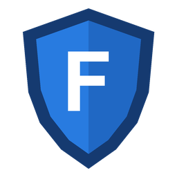
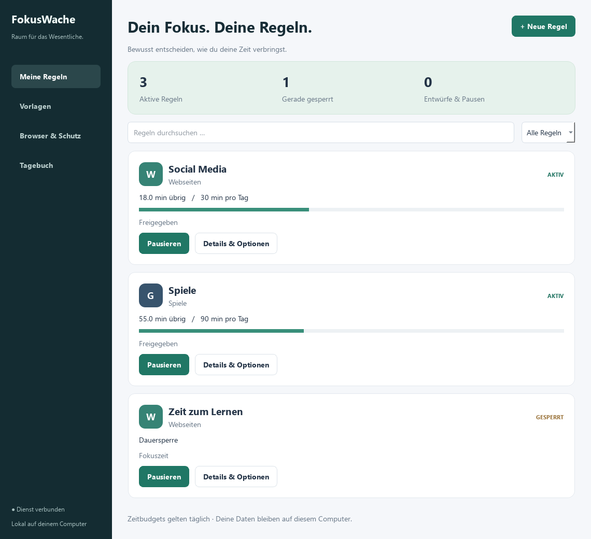
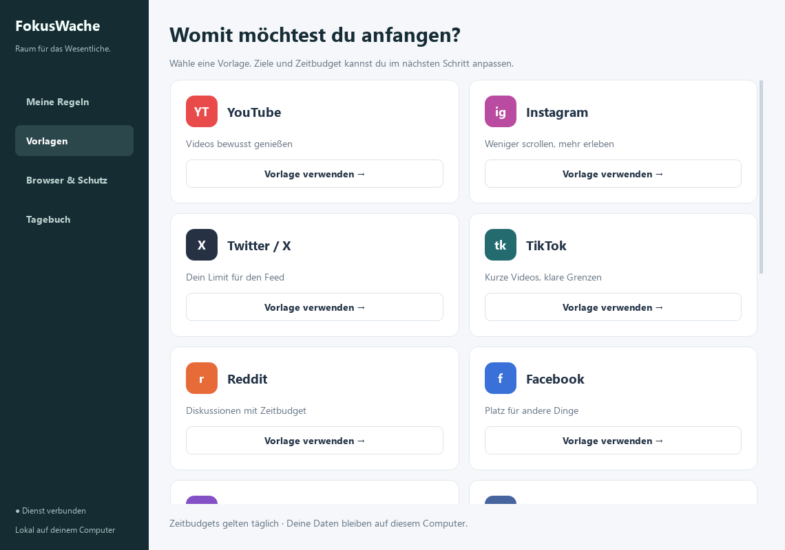
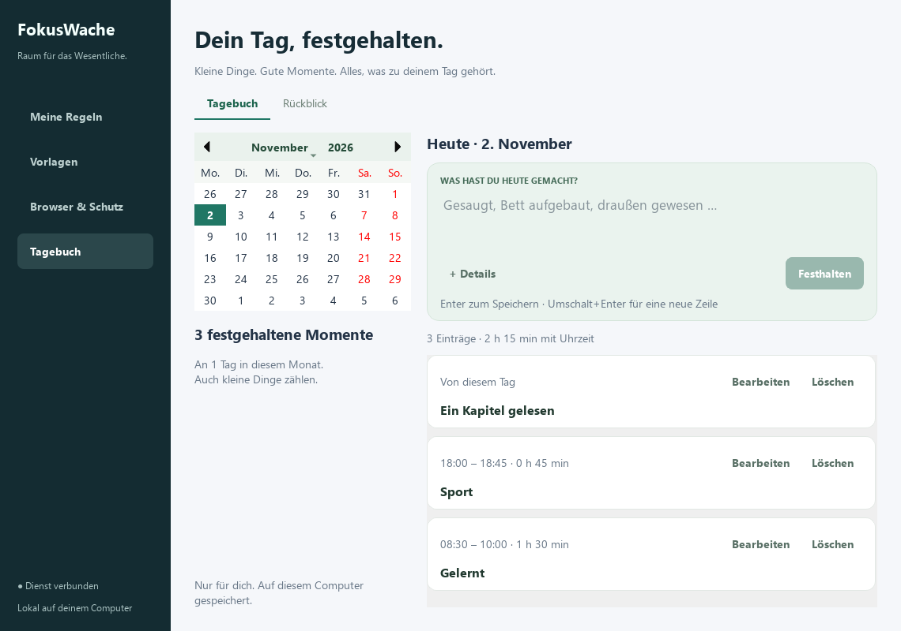
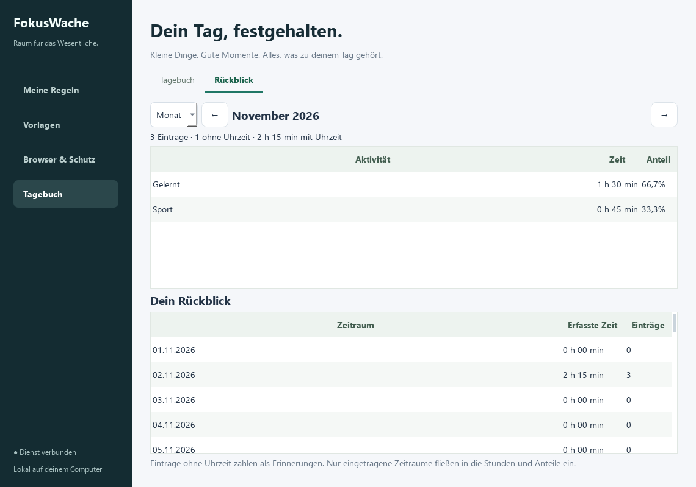

<div align="center">



# FokusWache

### Raum für das Wesentliche.

Webseiten, Spiele und Programme bewusst begrenzen.<br>
Mit Zeitbudgets, Wochenplänen und einem persönlichen Tagebuch – lokal auf deinem Windows-PC.


[](LICENSE)

[**Windows-Installer herunterladen**](https://github.com/Dolcruz/Fokuswache/releases/latest)

[Loslegen](#loslegen) · [Funktionen](#was-fokuswache-kann) · [Tagebuch](#dein-tag-festgehalten) · [Anleitung](docs/Installation.md)

</div>



FokusWache hilft dir, bei dem zu bleiben, was du dir vorgenommen hast. Lege fest, wie viel Zeit du einer App oder Webseite geben möchtest, plane feste Fokuszeiten und verriegle Regeln für einen selbst gewählten Zeitraum. Der Windows-Dienst setzt deine Regeln auch dann durch, wenn du das Fenster schließt.

## Was FokusWache kann

| | |
|---|---|
| **Webseiten begrenzen** | Domains samt Unterdomains oder bestimmte Pfade. Mit Domain-Ausnahmen für Seiten, die du weiterhin brauchst. |
| **Spiele gemeinsam zählen** | Ein Zeitbudget über erkannte Spiele aus Steam, Ubisoft, EA, Epic und GOG hinweg. Eigene Spielordner und EXE-Dateien ergänzen die Erkennung. |
| **Programme sperren** | Einzelne Anwendungen oder ganze Programmordner. Laufende passende Prozesse werden bei einer Sperre beendet. |
| **Deinen Rhythmus planen** | Tagesbudgets, mehrere Wochenfenster, Zeiträume über Mitternacht und sofort startende Fokus-Timer. |
| **Entscheidungen festhalten** | Verriegelte Regeln lassen sich bis zum gewählten Ende weder ändern noch pausieren oder löschen. |
| **Offline arbeiten** | Das gesamte Netzwerk pausieren oder den Computer nach einem sichtbaren Countdown sperren, abmelden oder herunterfahren. |

Zeitbudgets für Webseiten gelten für den aktiven Tab im fokussierten Browserfenster. Programme und Spiele zählen im Vordergrund; ein Launcher im Hintergrund verbraucht kein Spielbudget. Tageswechsel und Wochenpläne richten sich nach **Europe/Berlin**, einschließlich Sommerzeit.

## So wird aus einem Vorsatz eine Regel

1. **Wähle, was du begrenzen möchtest.** Nutze eine Vorlage oder füge eigene Webseiten, Programme und Spielordner hinzu.
2. **Bestimme deine Zeiten.** Tagesbudget, Wochenplan oder Fokus-Timer – mehrere Bedingungen lassen sich kombinieren.
3. **Aktiviere deine Regel.** Verriegle sie optional bis zu einem festgelegten Zeitpunkt. Die Übersicht zeigt Status und verbleibende Zeit.



## Dein Tag, festgehalten

Ein kurzer Satz reicht: gelernt, draußen gewesen, ein Kapitel gelesen. Im integrierten Tagebuch hältst du Erlebnisse fest, ergänzt bei Bedarf Uhrzeiten und schaust im Monats- oder Jahresrückblick auf deine Aktivitäten zurück.

| Tagebuch | Rückblick |
|---|---|
|  |  |

Einträge ohne Uhrzeit bleiben Erinnerungen. Nur ausdrücklich eingetragene Zeiträume fließen in die Stunden und Anteile ein. Das Tagebuch ist unabhängig von den Sperrregeln.

*Alle abgebildeten Ansichten zeigen die echte Anwendung mit Beispieldaten.*

## Loslegen

FokusWache ist für **Windows 10 und Windows 11, jeweils 64 Bit**, ausgelegt. Die Oberfläche ist auf Deutsch. Für Dienst, Firewall-Regeln und Browseranbindung benötigt die Installation Administratorrechte.

1. Lade **`FokusWache-Setup-1.0.0-x64.exe`** aus den [GitHub-Releases](https://github.com/Dolcruz/Fokuswache/releases/latest) herunter.
2. Öffne die EXE und bestätige die Windows-Administratorabfrage.
3. Folge dem Setup und starte anschließend **FokusWache** über das Startmenü oder direkt am Ende der Installation.

Python und alle Laufzeitbibliotheken sind enthalten. Du brauchst keine Entwicklungswerkzeuge und kein Konto. Die mitgelieferten Regeln sind zunächst deaktiviert. Das Setup ist noch nicht digital signiert; Windows kann deshalb einen unbekannten Herausgeber oder eine SmartScreen-Meldung anzeigen. Prüfsummen stehen im Release in `SHA256SUMS.txt`.

Updates installierst du mit demselben Setup. Schließe vorher das FokusWache-Fenster und lass aktive Verriegelungen ablaufen. Unter **Einstellungen → Apps → Installierte Apps → FokusWache** kannst du die Anwendung wieder entfernen. Regeln, Zeitkonten und Tagebuch bleiben erhalten.

**Für Webregeln ist zusätzlich die Browser-Erweiterung erforderlich.** Sie wird pro Browserprofil installiert. [Browser verbinden und Installation im Detail →](docs/Installation.md)

## Lokal auf deinem Computer

- **Kein Konto, kein eigener Cloud-Dienst, keine Telemetrie.** Oberfläche, Windows-Dienst und Browser-Erweiterung kommunizieren lokal über eine Windows-Pipe.
- **Keine gespeicherte URL-Chronik.** Die Erweiterung übermittelt Tab-Adressen zur lokalen Regelprüfung. Gespeichert werden Regeln, Zeitkonten und kurze Betriebsereignisse.
- **Getrennte Daten.** Regeln und Nutzungsbudgets liegen unter `%PROGRAMDATA%\FokusWache`. Dein Tagebuch liegt unter `%LOCALAPPDATA%\FokusWache\zeitprotokoll.sqlite3`.
- **Auch bei geschlossenem Fenster.** Der automatisch gestartete Dienst übernimmt die Durchsetzung; die Oberfläche zeigt und bearbeitet deine Regeln.

## Bewusst nutzen

FokusWache ist ein Werkzeug für persönliche Selbststeuerung. Ein Administrator kann Windows und die Installation weiterhin reparieren; ein Schutz gegen gezielte Manipulation, abgesicherten Modus oder speziell angepasste Browser wird nicht zugesichert.

Bei einer Programmsperre werden passende Prozesse beendet. Speichere offene Arbeit vor einer Sperrzeit. Eine vollständige Internetsperre umfasst auch lokale Netzwerkziele. Verriegelungen und Fokus-Timer lassen sich regulär erst nach Ablauf ändern; beginne mit einer kurzen Testregel.

Bei aktiven Webregeln kann ein Browser ohne bestätigte Erweiterungsverbindung eine Netzpause erhalten. Nach einer erfolgreichen Verbindung toleriert FokusWache kurze Unterbrechungen bis zu zwölf Sekunden; Fenster und Tabs bleiben dabei geöffnet. Die Firefox-Erweiterung ist noch nicht signiert und wird vorläufig als temporäres Add-on geladen.

[Betriebsverhalten und technische Grenzen →](docs/Betrieb.md)

## Entwicklung

Python, PySide6/Qt, pywin32, psutil und eine JavaScript-Erweiterung. Die Regeln werden zentral im Windows-Dienst ausgewertet; das Tagebuch verwendet SQLite.

```powershell
# Python-Tests und JavaScript-Prüfungen; zusätzlich Node.js erforderlich
.\.venv\Scripts\python.exe tools/check.py

# Screenshots mit isolierten Beispieldaten erzeugen
.\.venv\Scripts\python.exe tools/screenshots.py
```

Der Testlauf nutzt temporäre Nutzerdaten und Qt ohne sichtbares Fenster. Er installiert keinen Dienst und löst keine realen Sperren aus. [Projektaufbau und Build →](docs/Entwicklung.md)

## Lizenz und Drittanbieter

FokusWache steht unter der [MIT-Lizenz](LICENSE). Du darfst den Code frei verwenden, verändern und weitergeben, auch kommerziell. Der Copyright- und Lizenzhinweis muss dabei erhalten bleiben.

Drittanbieterkomponenten behalten ihre jeweiligen Lizenzen. Qt und PySide6 werden unter LGPLv3 verwendet. Lizenztexte und Hinweise werden mitinstalliert; die zugehörigen unveränderten Quellen stehen als separates Archiv im Release. [Komponenten und Lizenzquellen →](docs/Drittanbieter.md)
